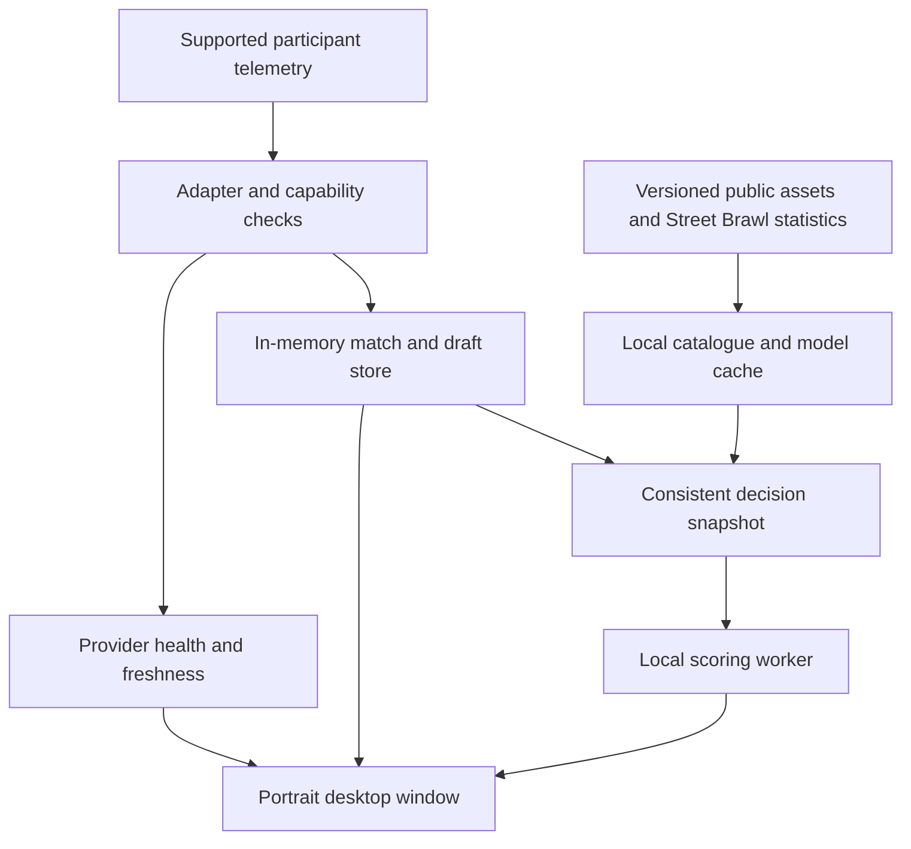

# Deadlock Street Brawl Windows companion plan

Research date: October 3, 2026, America/New_York. Prepared from eight research workstreams, primary provider documentation, Valve announcements and game assets, public API probes, and verified files from the earlier Deadlock research and companion project.

Build a desktop companion that automatically follows the player's own Street Brawl match and makes item-pick and reroll advice readable on a second portrait monitor. Automatic detection of current offers is a hard requirement. The first engineering milestone must prove a supported, timely structured data source; the research does not establish that the complete automatic application is feasible today.

The most promising path is an Overwolf-managed Deadlock integration extended to expose the local player's draft state. Overwolf already documents Street Brawl support, rosters, and purchased items. Its published Deadlock contract does not document unselected draft offers, remaining rerolls, or complete ability investment. Replay schemas demonstrate a possible representation for some missing fields, but do not establish live delivery or permitted use. [Overwolf Deadlock events](https://dev.overwolf.com/ow-native/live-game-data-gep/supported-games/deadlock/), [Street Brawl support changelog](https://dev.overwolf.com/ow-native/getting-started/changelog/ow-changelog/), [draft option schema](https://github.com/SteamTracking/GameTracking-Deadlock/blob/4c6431ccdb816d2911bbbaa4335169cc34140386/DumpSource2/schemas/client/ItemDraftOption_t.h)

## Product requirements

| Requirement | Intended behavior | Completion condition |
| --- | --- | --- |
| Automatic match and mode detection | Identify the local player, active match, team, and Street Brawl mode without entering a match ID | Demonstrated in the participant's own matches, including restart and a new match |
| Teams | Show the four players on each team and their heroes | Correct automatic seat and team mapping; missing identifiers handled explicitly |
| Inventories | Show each player's confirmed current items and relevant changes | Verify provider semantics for owned inventory, upgrades, removals, and completeness; purchased-item history alone is insufficient |
| Ability investment | Show automatically observed unlocks/ranks and changes; suggest the local player's next upgrade | Exact ranks must be supported and ordinarily visible to that participant; typical builds cannot substitute for actual investment |
| Own draft | Detect every offer set, position, item, bonus bundle, and modifier | Exact current offers arrive during drafting, before the decision expires |
| Pick recommendation | Rank legal current choices using the actual match context | Advice references the current offer generation and a compatible Street Brawl model |
| Reroll recommendation | Compare taking a current choice with spending an available reroll | Actual reroll availability and replacement rules are known; probability model validated against the current rules |
| Portrait display | Keep the decision, offers, score, and source status visible at a glance | Usable at a 720 by 1280 logical workspace and on larger portrait displays |
| No visual extraction | No screenshots, video capture, OCR, image matching, or computer vision in the data pipeline | Acquisition method confirmed for the chosen provider; no capture permission or recorder dependency |

There is no manual roster, item-offer, round, or reroll entry fallback in release scope. Synthetic scenarios are suitable for development, with a persistent Demo label. Human observation can establish laboratory ground truth without becoming a production input method.

The app provides advice. The player makes all selections, rerolls, purchases, and ability upgrades in Deadlock. The app never executes gameplay input. This scope follows the requested companion behavior and avoids Steam's automation restrictions. [Steam Subscriber Agreement, section 4](https://store.steampowered.com/subscriber_agreement/)

## What the research establishes

| Data route | Established evidence | Limitation and decision |
| --- | --- | --- |
| Overwolf Game Events Provider | Published local Deadlock roster/item contract; changelog explicitly adds Street Brawl | Best integration candidate. Test current coverage and obtain missing draft events. Do not assume every field works because game health is green |
| Deadlock API active matches | Public API lists matches appearing in the in-game Watch tab, limited to the top 200 | Cannot guarantee discovery of an ordinary user's current match; not the primary participant feed |
| Public spectator/live services | Indexed provider documentation reports a 60–90 second upstream spectator delay | Unsuitable for current draft advice. Advertised parse-to-delivery speed excludes that delay; separate live service reachability was not established |
| Replay/live schema and community parser | Draft items, bonus items, modifiers, round-state fields, and ability upgrade encodings exist | Useful for a provider extension specification and offline research. Schema presence does not prove populated Street Brawl offers or timely authorized local access |
| Match metadata and analytics | Street Brawl filters, completed-match item/ability data, item statistics, hero counters, and combinations | Useful for offline priors and evaluation; not evidence of current offers or live inventories |
| Static game assets | Round configuration, hero draft preferences, mode-specific values, and draft weights are available | Useful for mechanics and an offer model; pin to build, reconcile missing API fields, and validate the actual draw process |
| Steam presence and console diagnostics | Earlier work can read limited presence/version/log data | Does not supply the requested complete match state |
| Official Valve GSI | No public Deadlock-specific GSI contract was found in the reviewed sources | Do not invent a configuration file or assume Dota/CS integrations work in Deadlock |

Evidence: [Deadlock API contract](https://api.deadlock-api.com/openapi.json), [indexed live-service quickstart](https://live.deadlock-api.com/docs/quickstart), [community event parser](https://github.com/deadlock-api/deadlock-api/blob/f6e1974d45af3ccebe0f36324ea22e1e12990ff3/live-events/src/demo_parser/entity_events.rs), [game data mirror](https://github.com/SteamTracking/GameTracking-Deadlock/blob/4c6431ccdb816d2911bbbaa4335169cc34140386/game/citadel/pak01_dir/scripts/generic_data.vdata).

The older September 30 public Street Brawl probe is particularly useful negative evidence: its five draft-option arrays were empty. A successful HTTP request and a schema containing draft fields did not capture a player's actual choices. Its 1.32 second request time was transport latency, not measured spectator delay. The recovered files and limitations are documented in [research evidence](research-evidence.md).

## Street Brawl rules and versioning

Street Brawl was introduced as 4v4, best of five, with equal round resources and three inventory additions per round. Those original rules establish the format, not an immutable implementation. [Valve announcement](https://www.playdeadlock.com/oldgods)

The current mirrored game configuration reviewed on October 3 reports client version 6745/source revision 11078118 and these configured values:

| Configuration | Reviewed value | Application consequence |
| --- | --- | --- |
| Score to win | 3 | Support three to five rounds; derive current state from the feed |
| Buy time, rounds 1–5 | 50, 50, 50, 50, 65 seconds | Do not hardcode a flat 50-second countdown; prefer the actual provider deadline |
| Ability points per round | 6, 6, 5, 5, 10 | Model the current ability budget separately from typical upgrade order |
| Configured round rerolls | 1, 1, 1, 1, 1 | This is a base schedule, not proof of carryover, loss bonuses, or the player's remaining rerolls |
| Corruption round | 5 | Implement the representation behind a verified content/event flag |

These are configuration observations, not a direct gameplay validation of the installed client/server. The reviewed mirror commit is `4c6431ccdb816d2911bbbaa4335169cc34140386`. Its build timestamp has no timezone and must not be treated as an authoritative UTC deployment time. [Pinned build stamp](https://github.com/SteamTracking/GameTracking-Deadlock/blob/4c6431ccdb816d2911bbbaa4335169cc34140386/game/citadel/steam.inf), [pinned configuration](https://github.com/SteamTracking/GameTracking-Deadlock/blob/4c6431ccdb816d2911bbbaa4335169cc34140386/game/citadel/pak01_dir/scripts/generic_data.vdata)

Valve removed the Street Brawl item-slot limit on March 6. A 12-slot model, selling advice, or time-to-farm value would therefore be inappropriate without new contrary rules. February's notes also extend the Random Hero bonus reroll to Round 3; track that eligibility instead of assuming the base schedule is the full budget. Exact refresh, carryover, comeback effects, and replacement semantics remain integration tests. [March 6 official patch](https://store.steampowered.com/news/app/1422450/view/519740319207522795), [January 30 and February 4 official notes](https://forums.playdeadlock.com/threads/01-30-2026-update.102822/)

The configured ordinary-tier to rare-tier pairs vary by both round and pick stage. Round 1 uses 1→2, 2→3, 3→4; Round 2 uses 2→3, 3→4, 3→4; Round 3 uses 2→3, 3→4, 4→5; Round 4 uses 3→4, 3→4, 4→5; Round 5 uses 4→5 at all three stages. Some rare-allocation weights are zero. Do not use a flat round pool or treat every rare-tier field as a positive probability. [Pinned draft configuration](https://github.com/SteamTracking/GameTracking-Deadlock/blob/4c6431ccdb816d2911bbbaa4335169cc34140386/game/citadel/pak01_dir/scripts/generic_data.vdata)

September's City Never Sleeps update introduced a temporary corrupted-item event, including a Round 5 interaction. Its limited-time description and the surviving configuration do not prove that the event is active in every October 3 match. Both static support and runtime activation must be known. [Valve update](https://www.playdeadlock.com/cityneversleeps)

An offer is a bundle rather than merely an item name: the mirrored schema contains a main item, two possible bonus items, drafted/rare flags, item IDs, upgrade bits, and ability levels. Preserve that structure and any undecoded modifier. A rare flag alone does not establish a Legendary item. Do not collapse enhanced, legendary, corrupted, or bonus outcomes into the ordinary item. [Pinned option schema](https://github.com/SteamTracking/GameTracking-Deadlock/blob/4c6431ccdb816d2911bbbaa4335169cc34140386/DumpSource2/schemas/client/ItemDraftOption_t.h), [pinned item schema](https://github.com/SteamTracking/GameTracking-Deadlock/blob/4c6431ccdb816d2911bbbaa4335169cc34140386/DumpSource2/schemas/client/ItemDraftItem_t.h)

When runtime eligibility confirms the corruption event, handle it as a separate post-draft decision: an eligible non-enhanced owned item can gain an improvement and a downside. Capture the exact effects, eligibility, remaining opportunity, and skip option before suggesting a target. This capability requires its own provider extension and modifier evaluator. [Pinned corruption UI text](https://github.com/SteamTracking/GameTracking-Deadlock/blob/4c6431ccdb816d2911bbbaa4335169cc34140386/game/citadel/resource/localization/citadel_main/citadel_main_english.txt)

## How existing research contributes

The prior project supplies useful catalogue imports, evidence-aware state concepts, deterministic scoring, and source provenance. It does not supply an automatic current-offer feed or a validated reroll optimizer. Its catalogue was pinned to September 30 client 6723 and excludes Rat King as prerelease. Refresh it before use. Preserve code and research in the old directory; port only relevant capture-independent concepts.

The October 3 research includes 39 hero aggregate rows, item statistics for Rat King/Paige and a separate Graves query, and current asset snapshots. These are mode-specific observations and potential priors. They do not establish the marginal value of choosing an offered item in the current round.

Before importing statistics:

1. Recover request parameters, timestamp windows, retrieval times, and hashes into a provenance manifest. The aggregate JSON does not carry all these fields itself.
2. Reconcile hero IDs. One multi-hero item request mistakenly included 71; Graves is 76 and was fetched separately.
3. Investigate the dataset labelled pre–Rat King that contains Rat King appearances. The current hero aggregate implementation uses whole-day bounds, which can include appearances later on the cutoff day. This is a plausible explanation, not a proven diagnosis or an API-bug claim; exclude exact release-cohort interpretations until reconciled.
4. Set `game_mode=street_brawl` explicitly. The API defaults to normal. Do not inherit normal-mode badge/rank filters; Street Brawl has no badge data in the reviewed contract.
5. Use timestamp windows to approximate patch cohorts and record the limitation: the analytics contract has no direct patch-ID selector. Shared filters round to hours and item rollups use day-grained filters. A requested narrow cutoff is not proof of an exact release cohort.
6. Respect observation grain. Item statistics lack draft-round and enhanced/legendary dimensions. A corrupted-status filter exists, but it does not identify every rolled modifier. Repeated acquisition rows can contribute to the field called matches, so treat it as an observation count until deduplicated and cluster by match/player. Conditional buyer outcomes are not offer probabilities.

The reviewed item and ability analytics support useful queries, but eventual match duration, relative purchase time, and final net-worth filters must not enter a live decision as if known before the pick. Set Street Brawl mode explicitly on composition queries. Their full-team default handles four-player Street Brawl teams; request two-to-four hero subcombinations when needed. [API contract](https://api.deadlock-api.com/openapi.json), [pinned item-stat implementation](https://github.com/deadlock-api/deadlock-api/blob/f6e1974d45af3ccebe0f36324ea22e1e12990ff3/api/src/routes/v1/analytics/item_stats.rs), [pinned time filters](https://github.com/deadlock-api/deadlock-api/blob/f6e1974d45af3ccebe0f36324ea22e1e12990ff3/api/src/routes/v1/analytics/common_filters.rs), [pinned composition implementation](https://github.com/deadlock-api/deadlock-api/blob/f6e1974d45af3ccebe0f36324ea22e1e12990ff3/api/src/routes/v1/analytics/hero_comb_stats.rs)

## Recommended architecture

Prefer Overwolf Electron with TypeScript/React and a regular desktop window if its approved integration can meet the automatic telemetry gate. Its documented runtime exposes GEP and runs independently of the Overwolf Native client. Overwolf Native is a viable alternative host. Choose the exact maintained runtime versions during implementation. [Framework comparison](https://dev.overwolf.com/ow-electron/getting-started/onboarding-resources/frameworks-overview/)

WPF on .NET 10 remains suitable if a separately supported local interface becomes available. The existing WPF app cannot simply call GEP externally: Overwolf's C# plugin documentation targets .NET Framework 4.8, and no supported .NET 10 WPF relay was established. Tauri, ordinary Electron, and WinUI do not solve that access problem either. [Overwolf plugin documentation](https://dev.overwolf.com/ow-native/guides/dev-tools/plugins/writing-your-own-ow-plugin/), [Microsoft .NET support](https://dotnet.microsoft.com/en-us/platform/support/policy/dotnet-core)



| Component | Responsibility |
| --- | --- |
| Runtime/main process | Provider registration, lifecycle, HTTP updates, tray, monitor selection, and packaging |
| Telemetry adapter | Normalize documented events; preserve capability, identity, field visibility, and timing |
| Match store | Apply typed partial updates; manage complete snapshots, removals, unknown fields, and atomic match resets |
| Draft state machine | Track round, pick stage, draft identity, ordered offers, rerolls, phase, and source sequence |
| Scoring worker | Evaluate a frozen state/catalogue/model locally; return ranked choices, reasons, and evidence limits |
| Renderer | Display advice and observed state; never own telemetry credentials or execute gameplay |
| SQLite cache | Public catalogues, authorized statistical datasets, model manifests, settings, and migrations |
| Diagnostics | Operational health, timings, and aggregate failure counters; no raw game payloads/player identifiers |

Use packaged local UI, sandboxed renderers, context isolation, narrow validated IPC, and no remote executable content. No cloud or LLM request is needed during a draft. A network outage should not stop local scoring when the participant feed and compatible cached model remain valid. [Electron security](https://www.electronjs.org/docs/latest/tutorial/security)

Keep live GEP state in memory by default as a design decision. Overwolf instructs developers to avoid logging GEP data. Before recording normalized observations for later training, review applicable developer/privacy terms and obtain clarification where needed; the overview's logging warning alone does not establish a blanket separate-agreement requirement for every dataset. [GEP overview](https://dev.overwolf.com/ow-native/live-game-data-gep/live-game-data-gep-intro/), [developer terms](https://legal.overwolf.com/docs/overwolf/developers/developer-terms/)

Use the canonical `https://api.deadlock-api.com/v1/assets/*` endpoints with client-version pinning. Keep public statistics in a separate mode/window-labelled cache: item analytics have a six-hour server cache, and other analytics commonly one hour. Source code specifies shared analytics quotas of 200 requests/minute per IP, 400 per key, and 2,000 globally; observe returned headers and back off on `Retry-After`. Refresh in the background between matches rather than querying for every offer. The API software's MIT licence does not itself license Valve assets or approve a game integration. [Pinned API quota configuration](https://github.com/deadlock-api/deadlock-api/blob/f6e1974d45af3ccebe0f36324ea22e1e12990ff3/api/src/routes/v1/analytics/mod.rs), [pinned asset contract](https://github.com/deadlock-api/deadlock-api/blob/f6e1974d45af3ccebe0f36324ea22e1e12990ff3/api/src/routes/v1/assets/common.rs), [repository licence](https://github.com/deadlock-api/deadlock-api/blob/f6e1974d45af3ccebe0f36324ea22e1e12990ff3/LICENSE)

### State correctness

Every observed field needs provider, match/seat identity, observation time if available, received time, sequence or source watermark, availability, visibility, and completeness. Steam IDs remain strings; roster slots are needed when IDs are blank or duplicated for bots.

Track `changedAt` separately from `confirmedAt`. An unchanged inventory can remain valid while a trusted event stream is continuous; a newly received copy of an old spectator snapshot is not newly observed state. Continuity establishes ordering, not absolute freshness. Record the source clock and clock-offset uncertainty, or an independently bounded delivery contract; otherwise source age stays unknown. Distinguish a complete three-item inventory from three known items in an incomplete inventory.

A decision snapshot is keyed by match, round, draft ID, offer generation, inventory revision, ability revision, and model version. When the adapter accepts a pick, reroll, new offer, round transition, disconnection, or incompatible asset update, atomically invalidate dependent scores. Reject late worker results from an old generation. Separately measure and bound the interval between the game transition and its arrival; zero latency is not possible. Advance inventory only when a supported game update confirms the player's action.

Pin the catalogue/model for the match. Validate unknown item IDs and modifier bits rather than matching by display name. The source adapter must explicitly report whether a change is a complete snapshot, additive delta, removal, replacement, or upgrade. The old positive-only inventory merge cannot establish full current ownership.

## Item and reroll recommendations

Start with an explainable mechanics model, informed by properly scoped historical priors. Train more ambitious outcome models only after sufficient decision-context data is available. An aggregate item win rate cannot honestly become a promise of optimal live drafting.

For each legal current option, apply its entire bundle to the known loadout and calculate marginal value:

- Hero and ability scaling: gun/spirit allocation, cooldown thresholds, charges, reach, and the actually invested abilities.
- Existing loadout interaction: upgrades, shared effects, stacking rules, diminishing returns, and triggered synergies.
- Enemy answers: healing suppression, debuff handling, damage mitigation, control answers, and range/mobility needs supported by observed items and hero mechanics.
- Team contribution: coverage gaps, redundant non-stacking utility, protection for teammates, and damage balance.
- Round horizon: current score, number of rounds potentially remaining, ability budget, and immediate teamfight needs.
- Execution cost: active-item attention and the player's chosen style, if configured. Never assume an active item is used perfectly.
- Evidence strength: build compatibility, sample support, missing inventories/ranks, and uncertainty about the option's effects.

Use Street Brawl-specific asset values where provided. Examples found in the current assets include different Bounce Pad cooldown and Pulse Grenade radius; ordinary-mode tooltips alone are insufficient. Property scaling/functions and corruption effects need tested evaluators rather than copying the old tag heuristic. [Generic assets](https://api.deadlock-api.com/v1/assets/generic-data), [item assets](https://api.deadlock-api.com/v1/assets/items)

Present the recommendation as an item name and two concrete reasons, with missing-context qualifiers. Do not present an arbitrary score as a probability of winning. Statistical confidence about a historical frequency is separate from confidence that an item counters this exact match.

### Reroll decision

For state `s`, current offers `O`, and legal reroll budget `r`, compare the best pick's continuation value with a reroll's continuation value:

```text
V(s, O, r) = max(best legal pick value,
                 expected value after a legal reroll)

pick value = immediate marginal utility of the full bundle
             + value of remaining picks and possible later rounds

reroll value = expectation over the verified replacement process
               with updated reroll budget and remaining time
```

The continuation term prices scarce rerolls; do not subtract a second arbitrary reroll penalty that double-counts that scarcity. Include deadline/interaction risk separately. Unless experiments establish retention, a reroll gives up the current offer; the best current item is not a guaranteed fallback.

Current assets provide draft rarity/enhancement weights and hero preferences, which can seed an offer model. They do not yet prove the joint draw algorithm, duplicate exclusion, upgrade eligibility, special-item generation, or exact replacement behavior. Some weight fields are distributions over counts, not standalone percentages. Validate the full process before computing precise reroll odds.

Recommend reroll only when it is legal and the improvement is robust across plausible probabilities and value uncertainty. Prefer the best available choice when the comparison is uncertain but the current bundle is understood. If the offer, variant, legal reroll state, or required model is unverified, withhold the affected directive. Do not run a probability-free rule such as reroll until a favourite item appears.

### Research and evaluation

Public completed-match purchases establish selected outcomes, not rejected offers. A later empirical policy needs offer sets including unchosen items, all bundles, before-action state, reroll/replacement transitions, elapsed decision time, selected action, and round/match outcomes, collected only through an allowed method.

Evaluate with chronological patch splits and match-level grouping. Keep both teams and all rounds of one match in the same split. Compare the proposed policy with hero-only, fixed-build, and mechanics-only baselines. Use calibration and utility regret where counterfactual ground truth is available; observational win rate by itself cannot measure policy lift. Off-policy evaluation requires action propensities and adequate overlap, which the current saved aggregates do not supply. Check capture failures by round/hero/patch so an analysis of only successfully decoded offers does not hide selection bias.

A later controlled advice trial can measure whether offering the recommendation helps users. Its randomized advice probability is not the probability that a human selects that item; causal item value remains a separate estimation problem. Appropriate off-policy methods depend on overlap and valid propensity assumptions. [Doubly robust policy evaluation research](https://arxiv.org/abs/1103.4601), [sequential policy evaluation research](https://proceedings.mlr.press/v48/jiang16.html)

The first model release should advertise transparent situational advice and its evidence limits. Its success is accurate identification, useful reasoning, and reliable state transitions; it is not a verified increase in win rate.

## Portrait experience

Keep the answer in the upper third during drafts. Preserve offers in their game positions; mark the preferred card instead of rearranging them. During combat, elevate the roster/current build and retain the last confirmed round summary. The following layout is a design proposal, not a live match or an item recommendation:

```text
┌───────────────────────────────────────────────┐
│ STREET BRAWL            Source status          │
│ Round / score / confirmed draft deadline       │
├───────────────────────────────────────────────┤
│ PICK [ITEM] or qualified REROLL advice         │
│ Two short reasons / uncertainty               │
├───────────────────────────────────────────────┤
│ Current ordered offers and complete bundles   │
│ [Left option] [Middle option] [Right option]   │
│ Pick stage / actual rerolls / freshness        │
├───────────────────────────────────────────────┤
│ YOU: current items / actual ability ranks     │
│ Next ability suggestion when ranks are known  │
├───────────────────────┬───────────────────────┤
│ YOUR TEAM             │ ENEMY TEAM            │
│ Four hero rows        │ Four hero rows        │
│ Relevant/new items    │ Relevant/new items    │
│ Expand full inventory │ Expand full inventory │
├───────────────────────┴───────────────────────┤
│ Changes / evidence / display settings         │
└───────────────────────────────────────────────┘
```

At 1080 by 1920 physical pixels with 150% scaling, the logical workspace is approximately 720 by 1280. The same logical width occurs at 1440 by 2560 with 200% scaling. Keep the recommendation, three offers, source status, and score visible without scrolling there; wrap or expand inventories without a fixed slot cap. Save the chosen monitor, react to display removal/DPI changes, and avoid focus theft. [Electron display API](https://www.electronjs.org/docs/latest/api/screen), [Overwolf second-screen guidance](https://dev.overwolf.com/ow-native/guides/product-guidelines/app-screen-behavior/second-screen/)

Required states are Waiting for match, Waiting for draft data, Current draft, Connection interrupted, Unsupported build/item, Ability ranks unavailable, Post-match, and Demo. A connected source does not make every field current. Unknown values must not become zeroes, typical builds, or old-match values. Waiting for draft data has no actionable pick/reroll instruction.

Use readable adjustable text, sufficient contrast, labels alongside colour, and keyboard navigation within the companion. Optional shortcuts operate the companion only and must not intercept gameplay keys or automate the game. Default to hero names; allow player names to be hidden. Expand source details on demand rather than putting implementation jargon into the draft flow.

## Supported use and release dependencies

The companion itself will not implement process-memory readers, custom injection, hooks, or protected-traffic interception. This is a proposed engineering boundary, not a claim that all third-party integrations avoid those techniques. Overwolf's public material does not establish Deadlock's acquisition internals; confirm explicitly that the selected data path meets the no-image requirement. Do not describe it as Valve-approved or VAC-safe merely because GEP exists. [Steam rules](https://store.steampowered.com/subscriber_agreement/), [Overwolf GEP overview](https://dev.overwolf.com/ow-native/live-game-data-gep/live-game-data-gep-intro/)

Use the player's own offers and normally available match information. Do not expose enemy offers, hidden cooldowns/positions, or other spectator-only information. Exact opponent ability investment requires both technical coverage and evidence that the participant may access it. Public endpoint availability alone does not settle supported tactical use. [Steam Web API terms](https://steamcommunity.com/dev/apiterms)

Overwolf Electron requires app proposal approval/whitelisting and trusted code signing for distributed builds; its gaming packages do not load in an unsigned distributed executable. It also requires a visible desktop window. For an unpublished extension, Developer Terms section 4.1.12 requires prior written permission to access undocumented Platform APIs; use a documented extension or authorized development access. Plan for supported builder/installer, privacy documentation, provider QA, update rollback, and updates between matches. Approval and missing-event development have unknown external lead times. [Overwolf release requirements](https://dev.overwolf.com/ow-electron/getting-started/release-your-app/), [developer terms](https://legal.overwolf.com/docs/overwolf/developers/developer-terms/)

## Implementation sequence and gates

The estimates below are planning assumptions for focused engineering after access exists. They exclude provider development/review, signing procurement, and new data collection lead time.

| Stage | Work | Estimated effort | Exit gate |
| --- | --- | --- | --- |
| 0. Automatic integration proof | Capability specification, supported runtime, own-draft event inspector, inventory/rank coverage, real match validation, signed test build | 3–5 engineering days after access | Draft feasibility gate passes; full tracking gate separately verifies current inventories and permitted exact ranks; unsupported dependent work stays blocked |
| 1. Catalogue and data audit | Refresh pinned assets, mode overrides, hero-ID fixes, patch-window audit, modifier evaluators, model manifest | 4–6 days | Reproducible Street Brawl bundle; known incompatible data excluded |
| 2. Match store and portrait shell | Supported adapter, draft state machine, cancellation, roster/inventory/rank panels, monitor/DPI support | 5–7 days | Real automatic state updates and missing-source behavior work across transitions |
| 3. Situational scoring | Marginal bundle evaluation, explanations, ability advice, validated offer/replacement model, conservative reroll comparator | 5–8 days | Locally computed, traceable current advice; unsupported inputs never masquerade as known |
| 4. Alpha and distribution | Real-match coverage, latency/performance, update failures, signed installer, provider QA and privacy | 5–10 days | Measured release criteria met in a distributed build |

Plan approximately five to seven engineering weeks after the integration gate, with external lead time reported separately. A schema discovery or an offline demo does not pass Stage 0. Draft feasibility allows drafting-model and portrait-shell work to proceed; it does not establish the full requested tracking scope. Current inventories and permitted exact ability investment have a separate full-scope gate before their dependent features or complete-product delivery. If the supported provider cannot expose current offers, the requested automatic product remains dependent on a provider extension or a future Valve interface; manual entry is not the replacement deliverable.

### Acceptance targets to measure

- Correct automatic local player, three teammates, four opponents, and game mode across every tested match.
- Every tested offer, position, bundle, and variant agrees with direct human observation; no silent mismatches.
- Initial discovery in at least three complete matches, followed by an alpha corpus proposed at twenty matches/at least two hundred offer generations, including picks, rerolls, and special variants where active.
- Proposed p95 true draft-change-to-visible-advice latency at or below one second. Establish game-origin clock mapping with offset uncertainty or an independently bounded delivery contract; otherwise report only receive-to-render timing and mark the true timing target unverified. Human observation alone cannot substantiate subsecond end-to-end p95.
- Proposed scoring p95 below 100 ms and provider-received-to-render p95 below 500 ms, measured on the target PC.
- Atomically remove superseded advice when a transition is accepted by the adapter, reject old-generation worker results, and separately bound game-transition-to-receipt delay; disconnect/unknown-build paths remove affected advice.
- Automatically observed ranks required before ability tracking is called complete. If some requested fields remain unsupported, record the scope gap; do not silently declare the full vision delivered.
- Legible key content at 720 by 1280 logical units, mixed DPI scaling, and monitor disconnect/reconnect; no update steals game focus.
- Distributed signed build produces the same telemetry as development mode; caching and model rollback recover correctly.
- No capture pipeline, no production manual-entry path, no game-input automation, and no unapproved telemetry payload retention.

Prioritize meaningful adapter/state/model contract tests: partial vs complete inventories, item removal/upgrades, duplicate/out-of-order updates, old-offer worker results, restart hydration, modifier decoding, mode/build mismatch, and missing model probabilities. Real telemetry correctness requires real-match observation; unit tests cannot establish feed coverage or permission.

## Recommended next action

Execute the automatic telemetry proof in [the integration specification](automatic-telemetry-proof.md). The most valuable result is a capability report showing exactly what a supported provider can deliver during the player's own Street Brawl draft. That report determines whether we can implement this product as requested and which fields need provider work before building the full desktop application.
